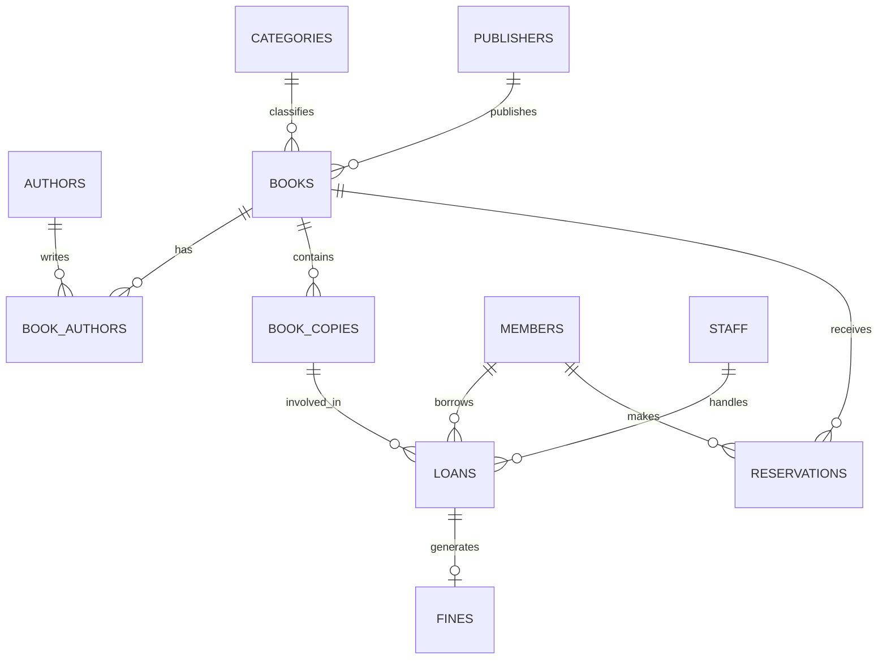

# Entity Relationship Diagram – Library Management System

## 1. Overview

The Entity Relationship (ER) diagram represents the structure of the Library Management System database. It illustrates the entities, their primary keys, foreign keys and relationships.

The database consists of 11 entities:

1. Authors
2. Categories
3. Publishers
4. Books
5. Book_Authors
6. Members
7. Staff
8. Book_Copies
9. Loans
10. Reservations
11. Fines

## 2. Visual ER Diagram



## 3. Textual ER Diagram

The textual representation below shows the entities, their attributes, primary keys (PK) and foreign keys (FK).

### AUTHORS
- author_id (PK)
- author_name
- country
- email

### CATEGORIES
- category_id (PK)
- category_name
- description

### PUBLISHERS
- publisher_id (PK)
- publisher_name
- city
- country

### BOOKS
- book_id (PK)
- title
- isbn
- category_id (FK)
- publisher_id (FK)
- publication_year
- price

### BOOK_AUTHORS
- book_id (PK, FK)
- author_id (PK, FK)

### MEMBERS
- member_id (PK)
- member_name
- email
- phone
- address
- membership_date
- status

### STAFF
- staff_id (PK)
- staff_name
- email
- designation
- hire_date

### BOOK_COPIES
- copy_id (PK)
- book_id (FK)
- barcode
- availability_status

### LOANS
- loan_id (PK)
- member_id (FK)
- copy_id (FK)
- staff_id (FK)
- issue_date
- due_date
- return_date
- loan_status

### RESERVATIONS
- reservation_id (PK)
- member_id (FK)
- book_id (FK)
- reservation_date
- reservation_status

### FINES
- fine_id (PK)
- loan_id (FK, UNIQUE)
- fine_amount
- payment_status
- fine_date

## 4. Connection Map

The following connection map explains how the database tables are linked.

```text
                         AUTHORS
                            |
                            | 1:M
                            |
                      BOOK_AUTHORS
                            |
                            | M:1
                            |
CATEGORIES 1:M ----------- BOOKS ----------- M:1 PUBLISHERS
                            |
                 +----------+----------+
                 |                     |
                 | 1:M                 | 1:M
                 |                     |
             BOOK_COPIES           RESERVATIONS
                 |                     |
                 |                     | M:1
                 |                     |
                 |                  MEMBERS
                 |
                 | 1:M
                 |
               LOANS
                 |
       +---------+---------+
       |         |         |
       | M:1     | M:1     | 1:0..1
       |         |         |
    MEMBERS    STAFF     FINES
```

## 5. Relationship Explanation

| Relationship | Type | Explanation |
|---|---|---|
| Authors – Books | Many-to-Many | A book can have multiple authors, and an author can write multiple books. The Book_Authors junction table connects them. |
| Categories – Books | One-to-Many | One category can contain multiple books. |
| Publishers – Books | One-to-Many | One publisher can publish multiple books. |
| Books – Book_Copies | One-to-Many | A book can have multiple physical copies. |
| Members – Loans | One-to-Many | A member can have multiple loan records. |
| Book_Copies – Loans | One-to-Many | A physical copy can appear in multiple loan records over time. |
| Staff – Loans | One-to-Many | A staff member can handle multiple loans. |
| Members – Reservations | One-to-Many | A member can make multiple reservations. |
| Books – Reservations | One-to-Many | A book can have multiple reservations. |
| Loans – Fines | One-to-One (optional) | A loan can have at most one associated fine record. |

## 6. Relationship Summary

- Primary keys uniquely identify records in each table.
- Foreign keys connect related tables.
- The Book_Authors table resolves the many-to-many relationship between books and authors.
- The Loans table connects members, book copies and staff.
- The Fines table connects fine information to loan records.

## 7. Conclusion

The ER diagram and connection map provide a clear representation of the Library Management System database. They explain how the 11 entities are connected and how primary keys and foreign keys maintain relationships and referential integrity.